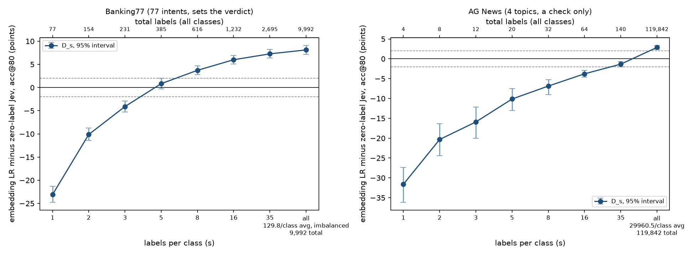

# I bet on Jev in public. Here is what a pre-registered test showed.

*Aarmen Sidhu, 6 November 2026*

**TL;DR.** On Banking77, a free logistic regression on sentence embeddings beats zero-label Jev once it has 8 labelled examples per intent (94.3% vs 90.6%). Jev leads only with 3 or fewer. The zero-shot methods often named as equivalents (NLI, embedding similarity, a constrained small LLM) were 12 to 29 points behind Jev. Given the same 8 examples, Jev did as well as the classifier. I wrote down the plan and the rules for reading the result before loading any test data. The whole test cost US$1.59.

---

## How this started

I commented on a LinkedIn post about Jev, a decision model from TypeSafe. You give it a question and a list of options with each request, and it returns one option with a confidence score. I argued it was more than a "rebranded classifier", because one model can take new options at request time without retraining.

A senior ML engineer replied with a fair challenge. Zero-shot NLI, embedding classifiers and constrained output models already do dynamic classification without retraining, and confidence-based escalation is an old technique. The comparison that matters, they said, is Jev against optimized lightweight classifiers, measuring cost, latency, calibration and accuracy at equal automation coverage.

That is a testable claim, so I tested it.

## Keeping myself honest

I had argued for Jev, so I didn't trust myself to read the results fairly after the fact. Before loading any test data, I:

- wrote the full plan: datasets, methods, settings, seeds and the exact metric;
- wrote a table saying which conclusion each possible result leads to;
- fingerprinted every file that affects the result (77 files) and made the repo public with the tag [`freeze-v1`](https://github.com/aarmens702-hub/jev-benchmark/tree/freeze-v1).

The code that loads test data refuses to run unless the files on disk match that public tag exactly. All predictions were saved before any correct answer was read, and the scoring script runs once and then locks.

One caveat: I had already seen some informal results from other people before writing the plan. So the design is locked in, but not blind.

## The setup

**The main test is Banking77.** It has 3,080 real customer banking messages, each labelled with one of 77 intents, like "card arrival" or "exchange rate". Only Banking77 decides the verdict.

**AG News is a side check.** It has 7,600 news headlines in 4 topics (World, Sports, Business, Sci/Tech). It shows whether the pattern holds on an easier task.

**The methods:**

| Method | Labelled examples | Runs on |
|---|---|---|
| Jev 1.14, with a short description of each intent | none | API |
| Jev 1.14, intent names only | none | API |
| Jev 1.14, with 8 examples per intent added to the request | 8 per intent | API |
| Zero-shot NLI (DeBERTa-v3-large) | none | laptop |
| Embedding similarity (BGE-small) | none | laptop |
| Small LLM (Mistral NeMo), forced to pick from the list | none | API |
| **Logistic regression on embeddings (the main comparison)** | 1 to all | laptop |
| Logistic regression with its setting tuned by cross-validation | 1 to all | laptop |
| TF-IDF + logistic regression | 1 to all | laptop |

The logistic regression was trained at 1, 2, 3, 5, 8, 16, 35 and all (about 130) examples per intent. Each count was repeated with 10 different random samples of examples, so one lucky sample can't decide anything.

## How it was scored

**Only confident answers count.** A routing system acts when it is sure and sends the rest to a person or a bigger model. So for each method, I sorted its answers by its own confidence and scored the top 80%. Plain accuracy would hide whether a method knows when it is wrong.

**The gap.** For each number of examples, the gap is the classifier's score minus Jev's, in percentage points.

**Who is "clearly ahead".** I resampled the test messages 10,000 times to see how much each gap could move by chance. A side counts as clearly ahead only if it leads by at least 2 points and the whole 95% range is on its side. Both sides face the same bar.

**The verdict table, written before the test:**

| Classifier clearly ahead from | Jev clearly ahead through | Conclusion |
|---|---|---|
| 1, 2 or 3 examples | any | A light classifier beats Jev with very few labels. |
| 5, 8 or 16 examples | 1 or more | Jev leads early, the classifier leads after. Jev's value is a cold start. |
| 5, 8 or 16 examples | none | The classifier leads from there. No clear difference below. |
| 35, all, or never | 3 or more | Jev leads when labels are scarce. |
| 35, all, or never | 0 to 2 | No clear winner when labels are scarce. |

My prediction, on record before the test: the classifier would be clearly ahead by 8 examples or fewer.

## The main result

*Classifier minus Jev at each number of examples per class, with 95% ranges. Dashed lines are the 2-point margin. Left: Banking77. Right: AG News.*

| Examples per intent | Classifier score | Gap to Jev | 95% range | Who is clearly ahead |
|---|---|---|---|---|
| 1 | 67.5 | -23.1 | -24.7 to -21.3 | Jev |
| 2 | 80.5 | -10.1 | -11.4 to -8.8 | Jev |
| 3 | 86.5 | -4.1 | -5.3 to -2.9 | Jev |
| 5 | 91.4 | +0.8 | -0.3 to +2.0 | neither |
| 8 | 94.3 | +3.7 | +2.8 to +4.7 | classifier |
| 16 | 96.6 | +6.0 | +5.1 to +6.9 | classifier |
| 35 | 97.9 | +7.3 | +6.4 to +8.2 | classifier |
| all (~130) | 98.7 | +8.1 | +7.1 to +9.1 | classifier |

*Banking77. Jev, with no examples, scored 90.6.*

The verdict, word for word from the table I wrote beforehand:

> **Jev leads through 3 labels per class and LR leads from 8. Jev's value on this task is limited to cold starts.**

8 examples per intent is 616 labelled messages in total. My prediction was right, and the engineer was right on the main point: on this task, a few hundred labels and a free classifier beat Jev.

The other two classifiers agreed. The cross-validated version also crossed at 8. TF-IDF was much weaker with few examples, and only clearly beat Jev with all of them.

## The zero-shot methods

This is the part of the engineer's claim I could test directly: do the older zero-shot methods already do what Jev does?

| Method (no examples) | Score | Gap to Jev |
|---|---|---|
| Jev, intent descriptions | 90.6 | |
| Jev, intent names only | 89.1 | -1.5 |
| Embedding similarity | 78.5 | -12.1 |
| Small LLM (Mistral NeMo) | 62.0 | -28.6 |
| Zero-shot NLI (DeBERTa-v3-large) | 61.6 | -29.0 |

None came within 2 points of Jev. They do accept options at request time, so on the interface the engineer is right. On accuracy, they were not a substitute here. Jev also barely needed the intent descriptions: with bare names it lost only 1.5 points.

## Jev with the same examples

Labels aren't only useful for training a classifier. I also gave Jev 8 examples per intent in the request, picked by word overlap with each message.

- Jev with 8 examples: **95.6**
- The classifier trained on that same sample of 8: **94.9**
- Gap: +0.8 for Jev (95% range -0.2 to +1.7), which counts as "at least as good" under my rules.

That's one sample of examples. Across all 10 samples, the classifier at 8 ranged from 93.0 to 95.1.

## Cost, speed and confidence

| Method | Cost per 1,000 messages | Typical response time | Calibration error | Confidence exactly 1.0 |
|---|---|---|---|---|
| Jev | US$0.10 | 0.18 s | 0.072 | 42% |
| Jev with 8 examples | US$0.13 | | 0.050 | 51% |
| Logistic regression, 8 examples | free, local | | 0.151 | 0% |
| Small LLM | US$0.03 | 1.58 s | 0.156 | 0% |

*Calibration error (ECE) measures how far a method's confidence is from its actual accuracy. Lower is better, and about 0.01 to 0.02 is the floor you'd expect from chance alone. Response times are medians of 44 requests from one location.*

Jev's confidence is better matched to its accuracy than the classifier's at 8 examples, but still well above the chance floor. It said exactly 1.0 on 42% of messages, which makes it hard to rank its most confident answers finely.

## Does it hold at other coverage levels?

The verdict is the same if you score the top 70%, 90% or all messages. At 50% coverage, where everything is near 98%, it becomes "no clear winner". I set the rule in advance to only change the headline for 70% or 90%, so the headline stands, but you should know about it.

Scoring every message instead of the top 80%: Jev 83.0, classifier 82.2 with 5 examples and 86.0 with 8.

## AG News: a different story

On the easier news-topic task, Jev scored 93.3 with no examples. It stayed clearly ahead of the classifier through 16 examples per topic. The classifier only clearly beat it with the full training set, about 30,000 examples per topic.

So the Banking77 result does not carry over to every task. Broad, easy categories favoured Jev. Fine-grained intents favoured the classifier.

## Can it follow a changed rule?

Jev's real selling point is changing behaviour without retraining, so I built a small made-up routing test. Each of 800 messages got three made-up account details. A written rule sent each message to one of 8 queues based on its topic and those details. The queues are named after colours, so nothing can guess from the name. Then I swapped in a second rule.

| Method | Rule A | Rule B |
|---|---|---|
| Intent classifier plus the rule written as code | 98.4 | 98.4 |
| Jev, rule given as text | 85.3 | 97.1 |
| Zero-shot NLI, rule as text | 71.1 | 79.6 |
| Small LLM, rule as text | 71.4 | 75.5 |
| Classifier trained on rule A, never retrained | 97.1 | 51.5 |

Under the new rule, Jev was within 1.3 points of the classifier-plus-code approach. The small LLM and NLI were 17 to 22 points behind Jev. So Jev followed a changed rule from text, with no labels, and the other text-based methods didn't come close.

To be fair: an engineer can get the same result by editing code, if they have intent labels. And Jev was noticeably weaker under rule A than rule B, which I didn't dig into. About 55% of messages here were routed by account details alone, so this tests rule-following more than topic understanding.

## What I got wrong

My original comment said a traditional classifier "is trained on fixed labels for one task". The engineer had named methods that aren't fixed-label, so that point didn't stand. I also said "most agent stacks" send every routing decision to an LLM. I have no evidence for that, so I take it back.

## So what should you use?

- **You have a few hundred labelled examples:** train a logistic regression on embeddings. It's free, fast and beat Jev here from 8 per intent.
- **You have none, or your options change often:** Jev was by far the best no-label option I tested, 12 to 29 points ahead of the alternatives.
- **You have a few examples and want to keep options flexible:** Jev with examples did as well as the classifier with the same examples.
- **Broad, easy categories:** Jev held on much longer on AG News.

## Limits

- **One model, one version.** Only Jev 1.14. A later version may behave differently.
- **Not blind.** I had seen earlier informal results before writing the plan, including Jev at about 83% on a sample and a classifier matching it near 5 examples per intent. The 80% cut-off, the example counts and my prediction were set after reading them.
- **Some settings came from earlier work.** The classifier setting and the example-retrieval recipe came from public comparisons that used labels this study doesn't count.
- **Possible memorisation.** Jev's training data isn't public, so it may have seen these datasets.
- **One main dataset.** AG News is a check, not a repeat. Messages that fit none of the intents weren't tested.
- **Methods left out for budget:** SetFit, fine-tuned transformers, open-source decision models and cascades.

## What it cost

The whole test run cost **US$1.59** in API calls, across 38,320 requests with zero failures. Setup and checks before the freeze cost about US$0.42 more. Everything else ran on my laptop.

## Check it yourself

Everything is in the [repo](https://github.com/aarmens702-hub/jev-benchmark): the frozen plan at tag [`freeze-v1`](https://github.com/aarmens702-hub/jev-benchmark/tree/freeze-v1), every prediction (with its confidence, cost and response time), every results table, the code, and a log of every change from the plan. The test sets are public, so anyone can match the predictions to the correct answers and recompute the numbers. The paid calls can be re-run with your own OpenRouter key.

Thanks to the engineer who pushed on this. It was the right question.
